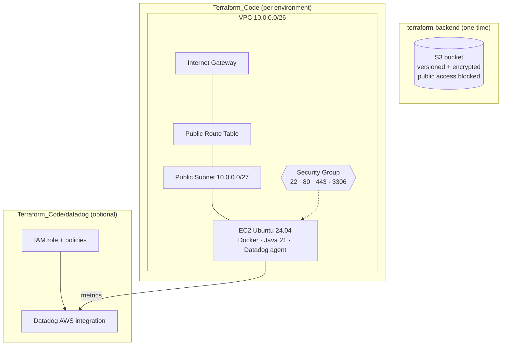

# Multi-Environment AWS Infrastructure with Terraform

Infrastructure as Code for a **multi-environment (dev / stage / prod) AWS setup**, built with reusable Terraform modules. Each environment provisions a VPC with a public subnet, a security group, and an Ubuntu EC2 instance that bootstraps itself with Docker, Java and the Datadog agent. A separate stack creates the **S3 bucket for Terraform state**, and another sets up the **Datadog ↔ AWS integration**.

---

## Table of Contents

1. [Architecture](#architecture)
2. [Repository Structure](#repository-structure)
3. [Prerequisites](#prerequisites)
4. [Environments](#environments)
5. [Modules](#modules)
6. [Input Variables](#input-variables)
7. [Outputs](#outputs)
8. [Getting Started](#getting-started)
9. [Datadog Integration](#datadog-integration)
10. [Tearing Down](#tearing-down)

---

## Architecture



**What gets created per environment**

| Layer | Resources |
|---|---|
| Network | VPC, public subnet, internet gateway, public route table + association |
| Security | Security group with ingress rules for SSH (22), HTTP (80), HTTPS (443), MySQL (3306) and an allow-all egress rule |
| Compute | EC2 instance from the latest Canonical Ubuntu 24.04 (Noble) AMI |
| Bootstrap | `user_data` installs Docker, enables it on boot, installs OpenJDK 21 and the Datadog Agent 7 |
| Tagging | Provider-level default tags: `Project`, `Environment`, `ManagedBy` |

## Repository Structure

```
Terraform_Project/
├── terraform-backend/            # Stack 1: remote-state S3 bucket
│   ├── main.tf
│   ├── variables.tf
│   ├── outputs.tf
│   └── terraform.tfvars
│
└── Terraform_Code/               # Stack 2: the environment infrastructure
    ├── main.tf                   # Wires the modules together + AMI lookup
    ├── providers.tf              # AWS provider (~> 6.0) + default tags
    ├── variables.tf
    ├── outputs.tf
    ├── environments/
    │   ├── dev.tfvars            # eu-north-1
    │   ├── stage.tfvars          # ap-south-1
    │   └── prod.tfvars           # us-east-1
    ├── modules/
    │   ├── vpc/                  # VPC, subnet, IGW, route table
    │   ├── security_groups/      # Security group + rules
    │   └── ec2/                  # EC2 instance + user_data
    ├── datadog/                  # Stack 3: Datadog–AWS integration (standalone)
    │   └── main.tf
    └── script/
        └── monitor.py            # Monitoring script (work in progress)
```

## Prerequisites

| Requirement | Notes |
|---|---|
| [Terraform](https://developer.hashicorp.com/terraform/install) | 1.x; the AWS provider is pinned to `~> 6.0` |
| AWS CLI + credentials | `aws configure`, with permissions for VPC, EC2, S3 and IAM |
| EC2 key pairs | One per environment/region **must already exist**: `dev_key` (eu-north-1), `stage_key` (ap-south-1), `prod_key` (us-east-1) |
| Datadog account | Only for the Datadog stack and agent: an API key and an application key |

## Environments

Each environment is defined by a `.tfvars` file in `Terraform_Code/environments/`.

| Environment | Region | AZ | VPC name | Instance name | Key pair | Instance type |
|---|---|---|---|---|---|---|
| **dev** | `eu-north-1` | `eu-north-1a` | `dev-tf-vpc` | `dev-terraform-instance` | `dev_key` | `t3.micro` |
| **stage** | `ap-south-1` | `ap-south-1a` | `stage-tf-vpc` | `stage-terraform-instance` | `stage_key` | `t3.micro` |
| **prod** | `us-east-1` | `us-east-1a` | `prod-tf-vpc` | `prod-terraform-instance` | `prod_key` | `t3.micro` |

All three use the same address space: VPC `10.0.0.0/26`, public subnet `10.0.0.0/27`. Because the environments live in different regions, the ranges never conflict.

## Modules

### `modules/vpc`
Creates the VPC, one public subnet, an internet gateway, and a public route table with a default route (`0.0.0.0/0`) to the gateway.
**Outputs:** `vpc_id`, `public_subnet1_id`, `internet_gateway_id`, `public_route_table_id`

### `modules/security_groups`
Creates a security group and one ingress rule per port, using the `aws_vpc_security_group_ingress_rule` / `egress_rule` resources. The source CIDR for each rule is a variable.

| Port | Purpose | CIDR variable |
|---|---|---|
| 22 | SSH | `ssh_ingress_cidr` |
| 80 | HTTP | `http_ingress_cidr` |
| 443 | HTTPS | `https_ingress_cidr` |
| 3306 | MySQL / RDS | `rds_ingress_cidr` |
| all | Outbound | `egress_cidr` |

**Outputs:** `security_group_id`, `security_group_name`

### `modules/ec2`
Launches the instance in the public subnet with the given key pair and security group. On first boot, `user_data` runs:

1. `apt update`
2. Install and enable Docker (`docker.io`)
3. Install `fontconfig` and `openjdk-21-jre` (Java runtime, e.g. for Jenkins)
4. Install the Datadog Agent 7 (`datadoghq.com` site)

**Outputs:** `instance_id`, `instance_public_ip`, `instance_key_name`

## Input Variables

Defined in `Terraform_Code/variables.tf` (defaults shown are used when a value isn't set in a `.tfvars` file).

| Variable | Description | Default |
|---|---|---|
| `aws_region` | Region to deploy into | `us-east-1` |
| `environment` | Environment name (used in tags) | `dev` |
| `cidr_block` | VPC CIDR | `10.0.0.0/26` |
| `vpc_name` | VPC name | `sarth-tf-vpc` |
| `public_subnet1_cidr` | Public subnet CIDR | `10.0.0.0/27` |
| `public_subnet1_name` | Public subnet name | `public-subnet-1` |
| `availability_zone` | AZ for the subnet | `us-east-1a` |
| `map_public_ip_on_launch` | Auto-assign public IPs in the subnet | `true` |
| `security_group_name` | Security group name | `sarth-terraform-sg` |
| `ssh_ingress_cidr` | Allowed source for SSH | `0.0.0.0/0` |
| `http_ingress_cidr` | Allowed source for HTTP | `0.0.0.0/0` |
| `https_ingress_cidr` | Allowed source for HTTPS | `0.0.0.0/0` |
| `rds_ingress_cidr` | Allowed source for port 3306 | `0.0.0.0/0` |
| `egress_cidr` | Allowed outbound destination | `0.0.0.0/0` |
| `instance_type` | EC2 instance type | `t3.micro` |
| `key_name` | Existing EC2 key pair name | `sarth_key` |
| `associate_public_ip_address` | Attach a public IP to the instance | `true` |
| `instance_name` | `Name` tag of the instance | `sarth-terraform-instance` |

The `terraform-backend` stack takes `aws_region`, `s3_bucket_name` and `environment` (set in its `terraform.tfvars`).

## Outputs

| Output | Description |
|---|---|
| `vpc_id` | ID of the VPC |
| `public_subnet1_id` | ID of the public subnet |
| `internet_gateway_id` | ID of the internet gateway |
| `public_route_table_id` | ID of the public route table |
| `security_group_id` | ID of the security group |
| `security_group_name` | Name of the security group |
| `ec2_instance_id` | ID of the EC2 instance |
| `ec2_instance_public_ip` | Public IP of the EC2 instance |
| `ec2_instance_key_name` | Key pair attached to the instance |

## Getting Started

### 1. Clone and authenticate

```bash
git clone <your-repo-url>
cd Terraform_Project

aws configure            # or export AWS_PROFILE / AWS_ACCESS_KEY_ID etc.
aws sts get-caller-identity
```

### 2. Create the remote state bucket (one time)

```bash
cd terraform-backend
terraform init
terraform apply          # reads terraform.tfvars automatically
```

This creates an S3 bucket (`sarth-terraform-state-0381` in `eu-north-1` by default; change `s3_bucket_name` since bucket names are globally unique) with **versioning**, **AES-256 encryption** and **all public access blocked**.

To store the environment state in that bucket, add a backend block to `Terraform_Code/providers.tf`:

```hcl
terraform {
  backend "s3" {
    bucket  = "<your-state-bucket>"
    key     = "multi-env/terraform.tfstate"
    region  = "eu-north-1"
    encrypt = true
  }
}
```

If you don't add one, Terraform keeps state locally.

### 3. Deploy an environment

Use **one workspace per environment** so each has its own state:

```bash
cd ../Terraform_Code
terraform init

# DEV
terraform workspace new dev        # first time; later: terraform workspace select dev
terraform plan  -var-file=environments/dev.tfvars
terraform apply -var-file=environments/dev.tfvars

# STAGE
terraform workspace new stage
terraform plan  -var-file=environments/stage.tfvars
terraform apply -var-file=environments/stage.tfvars

# PROD
terraform workspace new prod
terraform plan  -var-file=environments/prod.tfvars
terraform apply -var-file=environments/prod.tfvars
```

### 4. Verify

```bash
terraform output
terraform output ec2_instance_public_ip

ssh -i <path-to-key>.pem ubuntu@$(terraform output -raw ec2_instance_public_ip)

# On the instance
docker --version
java -version
sudo datadog-agent status
```

Allow a few minutes after the instance starts for `user_data` to finish installing everything (`/var/log/cloud-init-output.log` shows progress).

## Datadog Integration

The `Terraform_Code/datadog/` directory is a **standalone stack** that connects your AWS account to Datadog. It is applied separately from the environment stack.

**What it creates**

- An IAM role `DatadogIntegrationRole-sarth`, assumable by Datadog's AWS account using an external ID
- One or more IAM policies (`DatadogAWSIntegrationPolicy-N-sarth`) built from Datadog's required permission list, automatically split into chunks that fit under the 6,144-character IAM policy size limit
- Attachments for those policies plus the AWS-managed `SecurityAudit` policy
- A `datadog_integration_aws_account` resource with all regions included, cloud security posture management, extended resource collection, X-Ray traces and the Lambda log forwarder enabled

**Before applying**, open `datadog/main.tf` and set the Datadog `api_key`, `app_key` and `api_url` for your own Datadog account, and set `aws_account_id` to your AWS account ID.

```bash
cd Terraform_Code/datadog
terraform init
terraform plan
terraform apply
```

The EC2 `user_data` also installs the Datadog agent on each instance, so hosts report to Datadog once the integration is in place.

## Tearing Down

Destroy an environment with the same workspace and var-file used to create it:

```bash
cd Terraform_Code
terraform workspace select dev
terraform destroy -var-file=environments/dev.tfvars
```

Destroy the Datadog stack from `Terraform_Code/datadog/`. Destroy `terraform-backend` last, and only after no other stack is using the bucket for state.

---

## License

Add a license of your choice (e.g., MIT).
